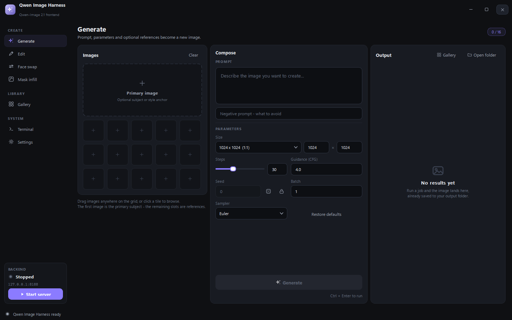

# Qwen Image Harness

[](https://github.com/XCisCoX/qwen-image-harness/actions/workflows/build.yml)

A desktop frontend for **Qwen-Image-2.1** on a consumer GPU: generate, edit, face-swap
and mask-infill, browse results, watch the engine's log. Qt/C++, no web stack, one binary.

The interesting part is not the UI — it is the **seam**. The app talks to an abstract
`Backend`; a reference client for a local ComfyUI ships with it, and swapping in your own
service is a one-line change in `harness/BackendFactory.cpp`. If you have your own
harness or API subscription, wire it there and keep the entire interface.


## What it does

| Page | What it is for |
|---|---|
| Generate | prompt → image, 1–16 reference images |
| Edit | change a photo with instructions, optional extra references |
| Face swap | identity transfer, same request shape as edit |
| Mask infill | paint a mask, re-render only that area — from scratch or keeping the original |
| Gallery | everything in the output folder, newest first |
| Terminal | the engine's log and this app's own backend messages |
| Settings | paths, server command, defaults, retention, accent colour |

Also: **on-the-fly scaling** of the primary image (defaults to ~1.0 MP, keeps aspect),
**a prompt queue** (submit as many as you like, they run in order), **optional live
preview** of the sampler, batch, seed lock,
per-run JSON sidecars, and a headless mode for scripting.

Unofficial community project. Not affiliated with, endorsed by, or supported by Alibaba or
the Qwen team; "Qwen" is their trademark and is used here only to say what the app runs.

## Requirements

* Linux with a CUDA GPU and a recent NVIDIA driver (validated: RTX 2060 SUPER 8 GB,
  Turing, driver 595, Ubuntu 24.04). 8 GB is the floor for the quantised stack.
* Windows 10/11 x64 for the frontend: the release zip bundles Qt, so nothing has to
  be installed. From source it needs Qt 5.12+ (MinGW 64-bit); see below. The ComfyUI
  engine is a separate install on either OS.
* Qt 5.15 (or Qt 6) + a C++11 compiler — `qtbase5-dev qttools5-dev-tools build-essential`.
* Python 3.10+ with `python3-venv`.
* ~18 GB disk without weights, ~40 GB with them.

The model weights are **not** included. They are downloaded from Hugging Face under the
Qwen Research License (research/evaluation only) — see `models.json`.

## Install

Deterministic path:

```bash
./setup.sh            # venv, ComfyUI v0.39.2, GGUF patch, weights, UI build, launcher
qwen-image-harness
```

Or hand the repository to an agent and point it at **AGENT.md** — it is written as a
gated procedure (probe → install → verify) with the failure table this stack earned the
hard way.

### Windows

Download `qwen-image-harness-<version>-windows-x64.zip` from Releases, extract it and run
`QwenImageHarness.exe`. Qt and the compiler runtime are bundled, so there is no installer
and nothing to configure.



From source, with any Qt 5.12+ MinGW 64-bit kit installed under `C:\Qt` (5.15.2 is what
CI uses):

```powershell
powershell -ExecutionPolicy Bypass -File .\harness\build-windows.ps1
# -> harness\dist\QwenImageHarness\QwenImageHarness.exe   (windeployqt output)
```

Pass `-Version 1.2.3` to stamp a version, `-ZipPath dist\out.zip` to produce the release
archive, or `-QtDir C:\Qt\5.15.2\mingw81_64` to pick a kit explicitly.

Only the frontend is built here. Install ComfyUI for Windows separately and point
Settings → Server at its interpreter and folder — the defaults are
`%USERPROFILE%\ComfyUI\venv\Scripts\python.exe` and `%USERPROFILE%\ComfyUI`, with
arguments `main.py --listen 127.0.0.1 --port 8188 --reserve-vram 0.8 --fp16-unet`.
`setup.sh`, `doctor.sh` and the model downloader remain Linux-only.

### Versions and CI

`.github/workflows/build.yml` builds both platforms on every push and pull request:

* **Windows x64** — Qt 5.15.2 MinGW 64-bit, `windeployqt`, zipped (self-contained).
* **Linux x86_64** — distro Qt 5.15 on Ubuntu 22.04, tarball with `harness/install.sh`.

The same version is stamped into the binary (`--version`, window title, Settings → About)
and into the artifact names:

| Trigger | Version |
|---|---|
| tag `v1.2.3` | `1.2.3` — also publishes a GitHub release with both artifacts |
| manual run with a `version` input | that value |
| any other push / PR | `<base>-dev.<run>.<sha>` |

Bump `<base>` in `harness/Src/QImageHarness.pro` when cutting a release, then tag
`v<base>`. To check a local build: `QwenImageHarness.exe --version`.

Headless smoke test:

```bash
qwen-image-harness --run "a brass key on dark slate" --steps 8 --out /tmp/out
qwen-image-harness --run "add a small flower here" --mode mask \
    --image photo.png --mask mask.png --out /tmp/out
```

## Backend seam (the "soldering pad")

```
harness/Backend.h              the contract: startServer / stopServer / submit / cancel
                               + stateChanged / progress / jobFinished / jobFailed
harness/BackendFactory.cpp     return your implementation here
harness/ComfyBackend.cpp       reference client: local ComfyUI over HTTP
harness/MockBackend.cpp        simulator: full UI, no GPU, no model
harness/docs/BACKEND.md        the request/result shapes and the rules
```

`GenerationRequest` carries prompt, negative, size, steps, cfg, batch, sampler, seed,
an ordered image list (`images[0]` is the primary) and an optional mask path. That is
everything the four workflows collect — a new backend needs nothing else.

## Mask infill options

Two engines, because they behave very differently on this model:

* **Edit + paste (default).** The model edits the whole picture with your prompt, and only
  the painted area is copied back - so materials, shading and highlights survive and
  everything outside the mask stays pixel-identical. This is what works for "engrave a star
  into this key", "change this label", "give this mug a handle". Qwen-Image-2.1 is an
  instruction editor, not an inpainting model.
* **Latent inpaint (classic).** VAE-encode a crop, mask its latent, sample. The model is
  handed a hole with no conditioning for what belongs there, so it tends to invent flat
  content that ignores the surrounding material. Kept for wholesale replacement, where you
  *want* the old content gone. Its knobs:
  * **Regenerate from scratch** - replace the masked pixels (matched colour or noise) so the
    model cannot read the old content. Off: the original stays visible.
  * **Fill** - matched colour from the ring around the mask, or noise (Fooocus style).
  * **Strength** - 1.0 replaces the region, 0.4-0.7 modifies it in place. It only helps with
    the fill *off*: if the content is erased there is nothing left to modify.
  * **Model sees** - area + surroundings (crop rendered at ~1024 px) or the whole image.
  * The sampler may also repaint ~12 px beyond the painted area while only painted pixels
    are pasted back, so it can blend its own edge.

The mask editor has a full-view mode: the expand button in its toolbar (or `F`) moves the
canvas and its controls into a window-filling view; `Esc` or *Close* puts everything back on
the page with the mask intact.

Both the Compose column and the mask column scroll instead of squashing when the window is
short.

Headless equivalents: `--inpaint-engine edit|latent`, `--inpaint-keep`,
`--inpaint-fill colour|noise`, `--inpaint-grow N`, `--inpaint-strength 0.05-1.0`,
`--inpaint-context full|area`.

## Mask infill, briefly

A hard cut-and-paste leaves a seam and lets existing geometry drift. The reference client
instead crops around the mask with context, upscales the crop, re-samples **only** the
masked latents, then blends back with a few pixels of feather along the painted edge.
Measured on a pole with hard edges: 0 changed pixels outside `mask + 14 px`, pole edges
bit-identical above and below the edit. `AGENT.md` §9 has the pipeline and §7 the test.

## Live preview

Settings -> Data controls has a "Live preview" switch. When it is on, the app opens the
engine's websocket and paints the sampler's own preview frames into the Output pane while
a job runs; the finished image is identical either way.

It needs the engine started with `--preview-method latent2rgb` (what this build's defaults
use). `taesd` also works if `models/vae_approx/taeqi2_1_decoder.safetensors` is present -
prettier, but it costs VRAM. ComfyUI only streams previews to a client that advertises
`supports_preview_metadata` and passes a matching `client_id` with the prompt; the app does
both, which is why a plain websocket client sees silence.

## Status

Working, verified on the hardware above: generate (42 s), base 25-step (88 s), edit (56 s),
multi-reference composition, RGBA output, mask infill with the invariants above. Known
gaps: 2048² does not fit (VAE decode needs ~7 GB), Settings → Apply does not re-apply
defaults to already-open pages, and batch results arrive as separate frames.

The Qt frontend also builds and runs on Windows x64 (CI does it on every push); the
engine steps and timings above describe the Linux + ComfyUI path.

## Licence

Code: MIT (see `LICENSE`), with one carve-out — `patches/comfyui-gguf-qwen-image-2.1.patch`
is a modification of GPL-3.0 code (ComfyUI-GGUF) and stays GPL-3.0. Everything else in
`harness/`, `setup.sh`, `AGENT.md` and the docs is MIT. Third-party components are **not**
bundled — see `NOTICE`.
Model weights are downloaded by the user and remain under the Qwen Research License.
